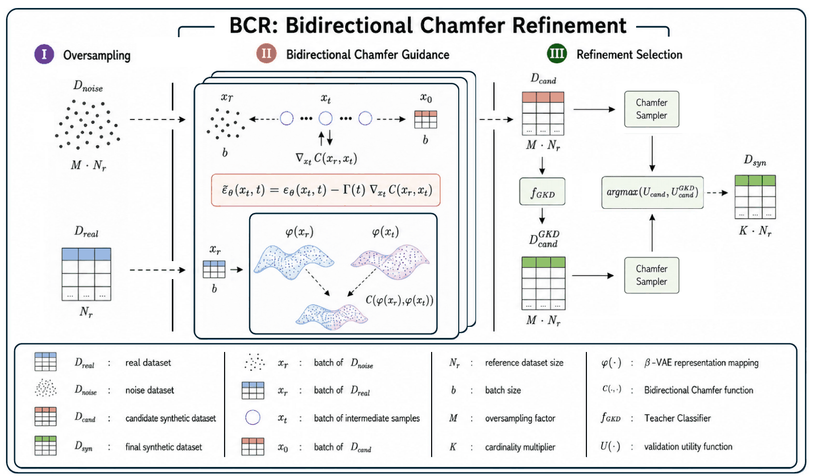

<div align="center">

# TARDIS

**Inference-Time Refinement Closes the Synthetic-Real Gap in Tabular Diffusion**

Eugenio Lomurno\*, Filippo Balzarini\*, Francesco Benelle\*, Francesca Pia Panaccione\*, Matteo Matteucci<br>
Politecnico di Milano · *NeurIPS 2026* · \*equal contribution

[Project page](https://eugeniolomurno.github.io/tardis/) · [Paper](https://arxiv.org/abs/2605.06261) · [Citation](#citation)

</div>

TARDIS (**T**abular generation through **R**efinement, **D**istillation, and **I**nference-time **S**ampling) improves the output of a frozen, pre-trained tabular diffusion model (TabDiff) at inference time, with no retraining. You give it a CSV, a target column and the task; it returns a synthetic dataset on which a downstream model (XGBoost by default) beats the same model trained on the real data on 12 of the 15 benchmarks of the paper (median +8.6%).



## Installation

```bash
git clone https://github.com/eugeniolomurno/tardis.git
cd tardis
pip install -e .
```

Requires Python ≥ 3.9 and PyTorch ≥ 2.0. A CUDA GPU is strongly recommended. On a single 2017 GTX 1080 Ti, refining a dataset takes 1 to 80 minutes; on an NVIDIA L40S it is 4.5× faster (median), and the one-time TabDiff training takes 2 to 6 hours.

## Usage

One command does everything:

```bash
tardis run --data adult.csv --target income --task binclass
```

It trains TabDiff once, searches the best configuration on a validation split, reports the test utility and writes the synthetic dataset to `runs/adult/synthetic.csv`. The data are split 90/5/5 into train, validation and test; `--val-size` and `--test-size` change the last two.

`--task` is `binclass`, `multiclass` or `regression`. Non-numeric columns are treated as categorical; use `--cat-cols a b c` to choose them yourself.

### Step by step

```bash
tardis train    --data adult.csv --target income --task binclass               # train the backbone
tardis search   --data adult.csv --target income --task binclass --trials 500  # search (resumable)
tardis generate --data adult.csv --target income --task binclass               # write synthetic.csv
```

### Without the search

```bash
tardis run --data adult.csv --target income --task binclass --trials 0
```

`--trials 0` skips the search and uses a fixed configuration (Chamfer Sampler, K = 10). It is much faster; the full search does better on 14 of 15 datasets in the paper.

To control how many rows you get, set `--K` (synthetic rows = K × real training rows) and keep `--M` (candidate pool size) just above it:

```bash
tardis generate --data adult.csv --target income --task binclass --M 10 --K 1
```

### Python

```python
from tardis import TARDIS, load_dataset

ds = load_dataset("adult.csv", target="income", task="binclass")
model = TARDIS(ds, workdir="runs/adult")
model.fit_backbone()
cfg = model.search(n_trials=500)
print(model.report(cfg))
synthetic = model.generate(cfg)
```

[`examples/quickstart.py`](examples/quickstart.py) runs the whole pipeline on scikit-learn's breast-cancer data with a small budget.

### Options

| Option | Default | Meaning |
|---|---|---|
| `--learner` | `xgboost` | downstream model: `xgboost`, `mlp`, `linear`, `random_forest` |
| `--trials` | `500` | search trials; `0` uses the fixed configuration |
| `--K` | searched | synthetic rows as a multiple of the real training rows |
| `--M` | `50` | candidate pool as a multiple of the real training rows |
| `--inner-trials` | `20` | trials of the β-VAE inner study |
| `--val-size` | `0.05` | validation fraction of all rows (early stopping and search) |
| `--test-size` | `0.05` | test fraction of all rows (final evaluation only) |
| `--workdir` | `runs/<csv name>` | where everything is written |
| `--device` | `cuda` if available | `cuda` or `cpu` |

Run `tardis <command> --help` for the full list.

### Outputs

| File | Content |
|---|---|
| `synthetic.csv` | the synthetic dataset, same columns as the input |
| `report.json` | test utility of Real, TabDiff and TARDIS |
| `best_config.json` | the configuration found by the search |
| `tabdiff.pt` | backbone checkpoint, reused by later commands |
| `search.db` | search state; rerunning `search` resumes it |
| `tardis.log` | full log of the run |

## Notes

<details>
<summary><b>Where each stage lives in the code</b></summary>

<br>

| Stage | What it does | Code |
|---|---|---|
| I · Oversampling | draws a pool of M·N<sub>r</sub> noise vectors | [`pipeline.py`](tardis/pipeline.py) `candidate_pool` |
| II · Bidirectional Chamfer guidance | perturbs the score with ∇C(φ(x<sub>t</sub>), φ(x<sub>r</sub>)) during reverse diffusion (Eq. 4) | [`guidance.py`](tardis/guidance.py), [`backbone/diffusion.py`](tardis/backbone/diffusion.py) `_denoise` |
| III · Refinement selection | keeps K·N<sub>r</sub> rows with one of four samplers, optionally after GKD relabelling | [`samplers.py`](tardis/samplers.py), [`pipeline.py`](tardis/pipeline.py) `select`, `teacher` |
| Search | TPE over Stage II; each trial returns the best validation utility of the Stage III grid, after a β-VAE inner study when the trial needs one | [`pipeline.py`](tardis/pipeline.py) `search`, `suggest_config`, `inner_study` |

The Chamfer functional C (Eq. 2) and its Stage II form are in [`chamfer.py`](tardis/chamfer.py), the β-VAE in [`vae.py`](tardis/vae.py), the TabDiff backbone in [`backbone/`](tardis/backbone).

</details>

<details>
<summary><b>Defaults from the paper</b></summary>

<br>

| | Setting | Value |
|---|---|---|
| Data | split | 90 / 5 / 5, stratified for classification; validation for early stopping and the search, test for the final evaluation |
| | imputation | median (numerical), mode (categorical), fitted on train |
| Utility ψ | binary / multiclass / regression | AUROC / weighted one-vs-rest AUROC / RMSE on the min-max normalised target |
| Backbone | TabDiff | learnable per-column noise schedules, 50 diffusion steps, 2-layer transformer (d<sub>token</sub> = 4), 8,000 epochs, batch 4,096, AdamW lr 10<sup>-3</sup>, EMA 0.997 |
| Stage I | pool multiplier M | 50 |
| Stage II | guidance | every t<sub>g</sub> of the 50 reverse steps; Γ = 0.05 for the constant family |
| | reference matching | global for batching ratio None or 1; for r < 1, by class (classification) or by k-means cluster of the target (k = 5, regression) |
| Stage III | samplers | Chamfer, MDSampler (k = 10), Stratified, IBOSS; each with and without GKD |
| | GKD teacher | XGBoost trained on one half of the real train split, early-stopped on the other half |
| Search | outer | Optuna TPE, 500 trials |
| | inner | β-VAE study, 20 trials, when a trial selects β-VAE mapping or the latent sampler |
| Evaluation | seeds | the candidate pool is generated once per configuration; every grid cell and the report average five runs (seeds 0–4), which change only the half of the real training data the GKD teacher is trained on and the selection of the stochastic samplers (Stratified, IBOSS); XGBoost has a fixed seed and a fixed split, so `± —` marks results whose five runs coincide (deterministic sampler without GKD) |

Downstream learners: XGBoost uses default hyperparameters, up to 10,000 rounds with early stopping (patience 250); `mlp` has hidden layers (128, 64); `linear` is logistic or ridge regression; `random_forest` has 500 trees. In Python, `learner` can also be any callable `(task, n_classes, seed) -> obj` whose object has `fit(X, y, X_val, y_val)` and `predict(X)` (see [`learners.py`](tardis/learners.py)).

With GKD, `synthetic.csv` keeps the hard target and adds the teacher's probabilities as `<target>__p_<class>` columns (classification), or replaces the target with the teacher's prediction (regression).

</details>

<details>
<summary><b>Search space (Table 7)</b></summary>

<br>

| Parameter | Domain | Scale |
|---|---|---|
| K | [0.1, 25.0] | linear, step 0.1 |
| guidance | {none, identity, β-VAE} | categorical |
| Γ(t) schedule | {constant, linear, cosine, sine} | categorical |
| γ<sub>max</sub> | [0.1, 5.0] | log |
| γ<sub>min</sub> | [10<sup>-8</sup>, γ<sub>max</sub> − 0.1] | log |
| t<sub>g</sub> (guidance interval) | [3, 20] | integer |
| batching ratio | {None, 1, 1/2, 1/4, 1/8, 1/10} | categorical |
| latent sampler | {off, on} | categorical |

The guidance parameters exist only when guidance is on. The Stage III grid (4 samplers × GKD on/off) is evaluated exhaustively inside every trial.

</details>

<details>
<summary><b>β-VAE inner study (Table 7b)</b></summary>

<br>

| Parameter | Domain | Scale |
|---|---|---|
| hidden layers | [1, 6] | integer |
| latent dimension d | {4, 8, 16, 32} | categorical |
| β<sub>max</sub> | [0.5, 10] | log |
| β(t) schedule | {constant, linear, cosine, sine, cyclical} | categorical |
| warmup W (non-constant schedules) | [10, 100] epochs | integer |
| T<sub>cyc</sub> (cyclical) | [5, 30] epochs | integer |
| dropout | [0, 0.4] | linear |
| batch norm, skip connections | {on, off} | categorical |
| learning rate | [10<sup>-5</sup>, 10<sup>-2</sup>] | log |
| epochs | [20, 500] | step 5 |

The inner study is a separate TPE study run for each outer configuration that selects β-VAE mapping or the latent sampler. Its objective is the utility of a uniformly random subset of K·N<sub>r</sub> candidates, averaged over five seeds.

</details>

<details>
<summary><b>Procedure details</b></summary>

<br>

- **Guidance.** Guidance is applied at the steps s = t<sub>g</sub>, 2t<sub>g</sub>, … of the 50-step reverse trajectory, on both the Euler and the second-order denoiser evaluations of a step. The perturbation is the gradient, with respect to the noisy numerical coordinates, of the bidirectional Chamfer functional evaluated on the backbone's prediction of the clean sample, with squared Euclidean distances scaled by 1/(4d). Categorical coordinates are discrete and receive no gradient, so guidance has no effect on datasets without numerical features.
- **Representation map φ.** The identity map z-scores the backbone's numerical encoding (quantile-normalised numerical columns, integer category codes) with the statistics of the set it is applied to; the β-VAE map takes the posterior mean of the encoder.
- **Γ(t).** With s the reverse step, constant: Γ = 0.05; linear: γ<sub>max</sub> + (γ<sub>min</sub> − γ<sub>max</sub>)·s/T; cosine: γ<sub>min</sub> + ½(γ<sub>max</sub> − γ<sub>min</sub>)(1 + cos(πs/T)); sine: γ<sub>max</sub> − ½(γ<sub>max</sub> − γ<sub>min</sub>)(1 + cos(πs/T)).
- **Reference matching.** With batching ratio r < 1, the larger of the real and candidate sets of a class is split into chunks of r times the real class size, each chunk is matched against the whole smaller set, the class is also matched as a whole, and the functional is averaged over all matched pairs. Classes are visited in index order; when a class has fewer real records than candidates, its pairs replace those of earlier classes.
- **β(t).** Constant: β<sub>max</sub>; linear: β<sub>max</sub>·t/W; cosine: β<sub>min</sub> + ½(β<sub>max</sub> − β<sub>min</sub>)(1 + cos(πt/W)); sine: β<sub>max</sub> − ½(β<sub>max</sub> − β<sub>min</sub>)(1 + cos(πt/W)); all equal β<sub>max</sub> from epoch W on; cyclical: β<sub>max</sub>·(t mod T<sub>cyc</sub>)/T<sub>cyc</sub>; β<sub>min</sub> = 0.5.
- **Chamfer Sampler.** Candidate features (target excluded) are one-hot encoded and z-scored on D<sub>real</sub> ∪ D<sub>cand</sub>; the pool is split in generation order into ten batches, each scored by C(B<sub>k</sub>, D<sub>real</sub>) with Euclidean distances; the best batches are kept until K·N<sub>r</sub> rows, the last one contributing its first rows.
- **MDSampler.** d(x) = max(0, ‖x − r\*‖² − ρ<sub>k</sub>(r\*)²), with r\* the nearest real record and ρ<sub>k</sub>(r) the distance from r to its k-th nearest real record (k = 10, r itself included), on one-hot encoded records with the target, or on β-VAE posterior means with the latent sampler.
- **Stratified.** The same number of candidates from every class (with replacement for small classes) or, for regression, from every decile of the candidates' target.
- **IBOSS.** For each of the p numerical features, the K·N<sub>r</sub>/(2p) candidates with the smallest and the largest values; then an equal share per category of each categorical feature; random candidates fill any remainder.
- **Backbone checkpoint.** The EMA weights with the lowest training loss in the second half of training.

</details>

## Citation

```bibtex
@inproceedings{lomurno2026tardis,
  title     = {Inference-Time Refinement Closes the Synthetic-Real Gap in Tabular Diffusion},
  author    = {Lomurno, Eugenio and Balzarini, Filippo and Benelle, Francesco and Panaccione, Francesca Pia and Matteucci, Matteo},
  booktitle = {Advances in Neural Information Processing Systems},
  year      = {2026}
}
```

## License

Released under the [MIT License](LICENSE).

The backbone in [`tardis/backbone/`](tardis/backbone) is adapted from the official [TabDiff](https://github.com/MinkaiXu/TabDiff) implementation (Shi et al., ICLR 2025). Those files remain subject to the licenses of the original projects; see [NOTICE](NOTICE).

## Contact

For questions or collaboration:

- Eugenio Lomurno: [eugenio.lomurno@polimi.it](mailto:eugenio.lomurno@polimi.it)
- Francesca Pia Panaccione: [francescapia.panaccione@polimi.it](mailto:francescapia.panaccione@polimi.it)
- Matteo Matteucci: [matteo.matteucci@polimi.it](mailto:matteo.matteucci@polimi.it)

---

<p align="center">Made with ❤️ at Politecnico di Milano</p>
